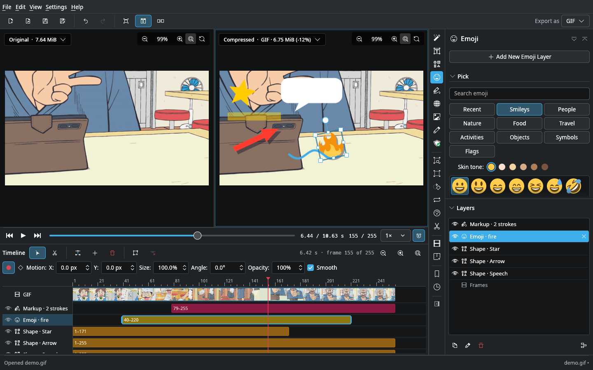
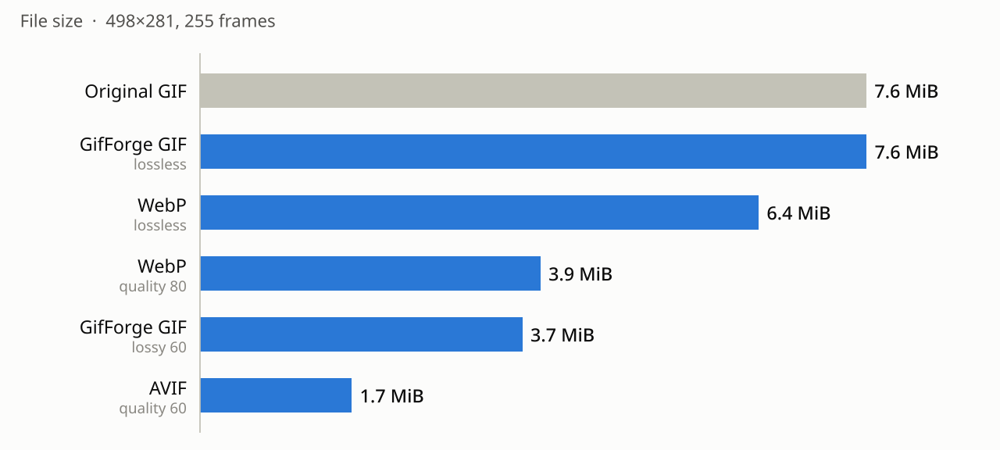
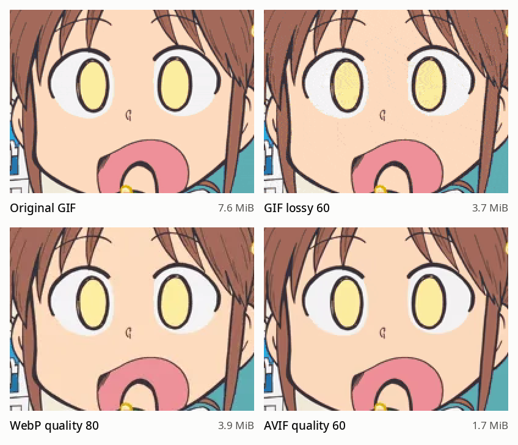

# GifForge

A GIF editor and optimiser that runs on your own machine. Runs on Linux, Windows and macOS.



## What it does

- Crop, resize, rotate, cut, change speed, reverse and more
- Effects, text, censor boxes, image overlays, watermarks and more 
- Everything is non-destructive, with full undo history and layer stack
- Side-by-side preview
- Export to GIF, WebP, AVIF, APNG, MP4/WebM
- Export with arbitrary file size target
- Presets you can reuse

## Examples 

Same 255-frame GIF with different export settings:

<picture>
  <source media="(prefers-color-scheme: dark)" srcset="docs/img/sizes-dark.png">
  
</picture>

Quality comparison (frame 1, zoomed 2×):

<picture>
  <source media="(prefers-color-scheme: dark)" srcset="docs/img/quality-dark.png">
  
</picture>

## Download

Grab a build from [Releases](../../releases), or build it yourself with: 

```bash
cargo run --release -- path/to/anim.gif
```

Linux dependecies are `libxkbcommon-dev` and `libgl1-mesa-dev`. MP4, WebM and AVIF export need `ffmpeg` on PATH.

## License

Apache 2.0 (see LICENSE). Bundled fonts: Noto Sans (OFL) and DejaVu.
